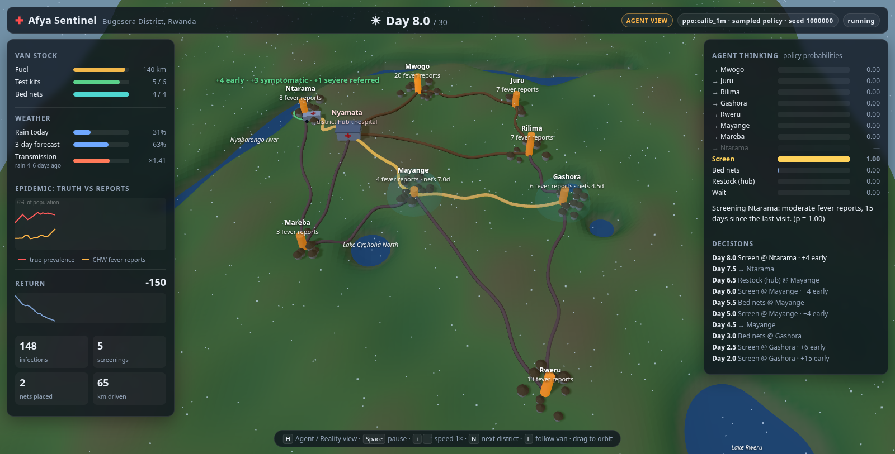
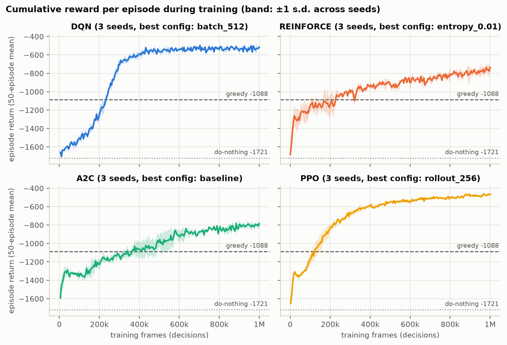

# Afya Sentinel

**Reinforcement learning for a mobile malaria early-detection van in Bugesera District, Rwanda.**

One agent dispatches a screening van around eight villages during a 30-day rainy season. Every half-day it chooses where to drive and whether to screen and treat, hand out bed nets, restock at Nyamata hospital or wait. It sees only lagged, noisy fever reports from community health workers, never the true infections. Four agents built with [TorchRL](https://github.com/pytorch/rl) (DQN, REINFORCE, A2C and PPO) are trained on the same custom Gymnasium environment and compared on 50 districts they never saw in training.



## Quick start

```bash
cd Hassan_Adelani_rl_summative
uv sync            # installs Python 3.12 and the pinned, CPU-only dependencies
uv run play.py     # watch the best trained agent: 3D viewer + verbose terminal log
```

You need [uv](https://docs.astral.sh/uv/getting-started/installation/). No GPU is needed. It runs on Linux, Windows and macOS on Apple Silicon (PyTorch 2.15 has no Intel-Mac wheels).

`uv run play.py` loads the best committed model (DQN), opens the viewer at <http://127.0.0.1:8000> and prints every decision in the terminal. `uv run main.py` does the same.

| Viewer key | Action |
|---|---|
| `H` | switch between **Agent View** (what the agent observes) and **Reality View** (the hidden epidemic) |
| `Space` | pause / resume |
| `+` / `-` | faster / slower |
| `N` | next district |
| `F` | follow the van (drag to orbit) |

Useful flags:

```bash
uv run play.py --algo ppo                    # dqn | reinforce | a2c | ppo | best (default)
uv run play.py --scenario heavy_rain         # default | heavy_rain | shuffled_hotspots
uv run play.py --seed 1000007 --speed 0.5    # another held-out district, slower playback
uv run play.py --no-browser --episodes 3 --compare-greedy   # terminal only, with baselines
uv run pytest                                # 106 tests, about a minute
```

## The environment

| | |
|---|---|
| **Map** | Real Bugesera geography. The hub is Nyamata district hospital, with villages in the Mwogo, Juru, Rilima, Gashora, Rweru, Mayange, Mareba and Ntarama sectors placed from real coordinates. |
| **Hidden state** | A stochastic S-E-I-Severe-R malaria model per village. Rain raises transmission 4–6 days later. Two hidden hotspots, infection spillover between villages. |
| **Decisions** | Semi-MDP: one decision per half-day tick, while journeys take 1–4 ticks depending on distance and flooding. |
| **Actions** (12) | Travel to one of 8 villages, Screen (test and treat), Bed nets (−60% transmission for 10 days), Return to hub (restock fuel, kits and nets), Wait. Invalid actions are masked using the observation. |
| **Observation** (55, in [0, 1]) | Van location, fuel, kits, nets, day, rain and a 3-day forecast. Per village: CHW fever reports (1-day lag, 50–90% complete), days since screening, last test positivity, travel time and net protection left. |
| **Reward** | +1 per early case found, +0.5 per symptomatic case, +1 per severe case referred; −1 per new infection, −3 per severe case, −0.01 per km, −20 if stranded, −30 if the outbreak escapes. No case can earn more than it cost (tested), and an early end is charged for the rest of the season. |
| **Episode** | Day 30, or earlier if the van runs out of fuel away from the hub or district prevalence passes 25%. |

The code is in [environment/custom_env.py](environment/custom_env.py) and the full description in the [report](report/Afya_Sentinel_Report.docx).

## Results

The best configuration of each algorithm was trained for 1M decisions with 3 seeds and evaluated on 50 held-out districts. Higher return is better.

| Agent | Held-out return (mean ± sd over seeds) | Infections averted vs doing nothing | Paired gain vs greedy [95% CI] |
|---|---|---|---|
| **DQN** (batch 512) | **−426.7 ± 7.4** | **802** | +661.3 [+606.2, +716.9] |
| PPO (rollout 256) | −459.6 ± 19.8 | 776 | +628.4 [+575.9, +681.1] |
| REINFORCE (entropy 0.01) | −736.7 ± 21.3 | 581 | +351.3 [+304.1, +398.0] |
| A2C (baseline) | −791.6 ± 66.4 | 558 | +296.4 [+245.5, +346.2] |
| greedy (most reports first) | −1088.0 | 323 | — |
| do nothing | −1720.8 | 0 | — |



- The trained agents spend 16–20% of their decisions on **bed nets placed ahead of forecast rain**, which greedy never does.
- **DQN** converges in the fewest frames but the most episodes, because its early random episodes are short.
- **PPO** is as robust to its hyperparameters as DQN; REINFORCE and A2C are far more sensitive.
- The agents generalise to heavier rain and to hotspots in new villages ([assets/tables/generalisation.md](assets/tables/generalisation.md)).

Every figure and table is generated from the logs: [assets/figures](assets/figures), [assets/tables](assets/tables).

## Reproducing the results

The committed `logs/` and `models/` hold every run behind the report: 52 sweep runs plus 12 final runs. To regenerate or extend them:

```bash
uv run main.py train --algo ppo --run-id my_run --set lr=1e-3        # one run (1M frames: ~16 min PG, ~46 min DQN per CPU)
uv run main.py evaluate models/pg/ppo/best --sets held_out heavy_rain
uv run main.py sweep --shard ppo --workers 3        # a whole sweep (resumable); shards: dqn reinforce a2c ppo final
uv run python -m analysis.baselines --scenarios default heavy_rain shuffled_hotspots
uv run python -m analysis.best_configs              # best sweep config per algorithm -> training/best_configs.json
uv run python -m analysis.publish_best              # best final model per algorithm -> models/*/best, models/best.json
uv run main.py figures                              # every figure and table in assets/
```

The sweeps ran on Kaggle CPU kernels. With Kaggle credentials in `~/.kaggle`, the launcher packages the current commit as a private dataset, pushes a kernel that runs `uv sync --frozen` and the shard, and merges the outputs back:

```bash
uv run python -m cloud.kaggle.launch up --shard ppo
uv run python -m cloud.kaggle.launch status
uv run python -m cloud.kaggle.launch pull --shard ppo
```

## Serving the model

`uv run main.py serve` starts the same FastAPI app without the demo loop:

| Endpoint | |
|---|---|
| `GET /` | the Three.js viewer (three.js is vendored, so no CDN is needed) |
| `POST /recommend` | `{"observation": [55 floats], "algo": "dqn"}` → recommended action, Q-values or probabilities, and a plain-language rationale |
| `GET /model-info` | the loaded models and their held-out scores |
| `GET /scene` | the map: locations, roads, lakes |
| `WS /ws/sim` | streams a live episode: frames, then a summary |

## Repository layout

```
play.py, main.py             entry points (main.py: play | train | sweep | evaluate | figures | serve)
environment/custom_env.py    the Gymnasium environment (ENV_VERSION 1.0)
environment/rendering.py     episode runner, terminal log, viewer frames
environment/viewer/          Three.js diorama (index.html, main.js, vendored three.js)
api/app.py                   FastAPI app: viewer, /recommend, /model-info, WebSocket stream
training/                    TorchRL training (dqn_training.py, pg_training.py), sweeps, seeds, CLI
analysis/                    baselines, run loading and validation, figures and tables, model publishing
cloud/kaggle/                Kaggle kernel launcher
models/dqn/, models/pg/      saved models (model.pt + config.json); */best/ are the published ones
logs/<algo>/<run>/           per-run training logs (gzipped CSV) and eval.json
assets/figures/, assets/tables/   generated report figures and tables
report/                      report (.docx) and video script
tests/                       pytest suite (environment, training, viewer and API, figures, tables, models)
```
